# THIẾT KẾ CƠ SỞ DỮ LIỆU: HỒ SƠ CBNV, LUÂN CHUYỂN CÔNG TÁC & ĐÁNH GIÁ TÍN NHIỆM
## QUỸ TÍN DỤNG NHÂN DÂN YÊN THỌ

> **Đơn vị áp dụng**: Quỹ Tín dụng Nhân dân Yên Thọ  
> **Địa bàn hoạt động**: Thôn Tân Lộc, xã Quý Lộc, tỉnh Thanh Hóa  
> **Cơ sở pháp lý**: 
> - Luật Các tổ chức tín dụng.
> - Quy định của Thống đốc NHNN về luân chuyển cán bộ nhằm phòng ngừa rủi ro đạo đức trong hệ thống tín dụng (đặc biệt đối với cán bộ tín dụng, kế toán, thủ quỹ).
> - Quy chế quản trị nhân sự & Quy chế bỏ phiếu tín nhiệm nội bộ QTDND Yên Thọ.

---

## 🏛️ 1. Sơ Đồ Thực Thể - Quan Hệ (ERD Diagram)

```mermaid
erDiagram
    EMPLOYEE ||--o{ WORK_HISTORY : "có quá trình luân chuyển"
    EMPLOYEE ||--o{ EMPLOYEE_TRAINING : "có chứng chỉ đào tạo"
    EMPLOYEE ||--o{ EMPLOYEE_KPI_HISTORY : "có lịch sử KPI"
    EMPLOYEE ||--o{ TRUST_EVALUATION : "thực hiện đánh giá (người chấm)"
    EMPLOYEE ||--o{ TRUST_EVALUATION : "nhận đánh giá (người được chấm)"
    EVALUATION_PERIOD ||--o{ TRUST_EVALUATION : "thuộc kỳ đánh giá"
    TRUST_CRITERIA ||--o{ EVALUATION_SCORE_DETAIL : "tiêu chí đánh giá"
    TRUST_EVALUATION ||--|{ EVALUATION_SCORE_DETAIL : "chứa chi tiết điểm 10 tiêu chí"
    EMPLOYEE ||--o{ TRUST_SUMMARY : "tổng hợp kết quả"
    EVALUATION_PERIOD ||--o{ TRUST_SUMMARY : "tổng hợp theo kỳ"

    EMPLOYEE {
        string id PK "Mã định danh duy nhất (UID / EMP_ID)"
        string uuid UK "Mã UUID bất biến v4 chuẩn RFC 4122 (VD: 3f8a9c2e-4b11-4a88-9d10-8b1e0f22c19a)"
        string code UK "Mã cán bộ (VD: CB01, CB02)"
        string name "Họ và tên đầy đủ theo CCCD"
        string gender "Nam / Nữ"
        string birthDate "YYYY-MM-DD"
        string cccd "Số CCCD (12 chữ số)"
        string phone "Số điện thoại di động"
        string email UK "Email công vụ nội bộ"
        string department "Phòng Tín dụng / Kế toán / BKS / HĐQT / BĐH"
        string position "Chủ tịch HĐQT, Giám đốc, Kế toán trưởng, CBTD, KSNB..."
        string positionStartDate "Ngày bắt đầu đảm nhiệm chức vụ hiện tại (YYYY-MM-DD)"
        string assignedArea "Địa bàn phụ trách hiện tại (Xã Quý Lộc, Yên Thọ...)"
        string politicalRole "Bí thư Chi bộ, Phó Bí thư, Chi ủy viên, Đảng viên..."
        boolean partyMember "true: Đảng viên ĐCSVN"
        date partyDate "Ngày kết nạp Đảng (YYYY-MM-DD)"
        date partyOfficialDate "Ngày công nhận chính thức Đảng (YYYY-MM-DD)"
        string education "Trình độ chuyên môn (Đại học Ngân hàng, Luật...)"
        string joinDate "Ngày bắt đầu công tác tại Quỹ"
        string contractType "Không xác định thời hạn, Theo nhiệm kỳ..."
        string role "staff | manager | chairman"
        string status "ACTIVE | LEAVE | INACTIVE"
        string avatar "Chuỗi Base64 ảnh chân dung đã nén qua Canvas (< 50KB)"
    }

    EMPLOYEE_TRAINING {
        string id PK "Mã bản ghi đào tạo (train-uuid)"
        string employeeId FK "Mã cán bộ (FK -> employees.id)"
        string employeeUuid FK "UUID cán bộ (FK -> employees.uuid)"
        string employeeName "Họ tên cán bộ"
        string courseName "Tên khóa đào tạo / bồi dưỡng nghiệp vụ"
        string organizer "Đơn vị tổ chức đào tạo (NHNN, Hiệp hội QTDND...)"
        string decisionNo "Số quyết định / Kế hoạch cử đi học"
        date startDate "Ngày bắt đầu khóa đào tạo"
        date endDate "Ngày kết thúc khóa đào tạo"
        string location "Địa điểm tổ chức đào tạo"
        string content "Tóm tắt nội dung đào tạo nghiệp vụ"
        boolean hasCertificate "true: Có cấp văn bằng / chứng chỉ"
        string certificateName "Tên văn bằng / chứng chỉ được cấp"
        string certificateNumber "Số hiệu văn bằng / chứng chỉ"
        date issueDate "Ngày cấp chứng chỉ (YYYY-MM-DD)"
        date expireDate "Ngày hết hạn hiệu lực"
        string grade "Kết quả / Xếp loại tốt nghiệp (Xuất sắc | Giỏi | Khá | Hoàn thành)"
        string certificateImage "Chuỗi Base64 ảnh scan chứng chỉ (< 50KB)"
        string notes "Ghi chú bổ sung"
        timestamp createdAt "Thời gian khởi tạo"
    }

    EMPLOYEE_KPI_HISTORY {
        string id PK "Mã bản ghi KPI (kpi-uuid)"
        string employeeId FK "Mã cán bộ (FK -> employees.id)"
        string employeeUuid FK "UUID cán bộ (FK -> employees.uuid)"
        string periodName "Tên kỳ đánh giá KPI"
        int year "Năm đánh giá KPI"
        int quarter "Quý đánh giá (1, 2, 3, 4)"
        float score "Điểm KPI tổng hợp (0 - 100)"
        string classification "Xếp loại kết quả (Xuất sắc | Tốt | Hoàn thành...)"
        string approvedBy "Người phê duyệt"
        timestamp createdAt "Thời gian phê duyệt"
    }

    WORK_HISTORY {
        string id PK "Mã bản ghi luân chuyển (TRANS_ID)"
        string employeeId FK "Mã cán bộ (FK -> users.id)"
        string employeeUuid FK "UUID cán bộ (FK -> employees.uuid)"
        string employeeCode "Mã cán bộ (CB01, CB02...)"
        string employeeName "Họ tên cán bộ"
        string decisionNumber "Số quyết định (VD: 15/QĐ-HĐQT-2024)"
        date decisionDate "Ngày ký quyết định"
        date effectiveDate "Ngày quyết định có hiệu lực"
        string transferType "LUAN_CHUYEN_DINH_KY | BO_NHIEM | DIEU_DONG | THAY_DOI_DIA_BAN"
        string fromDepartment "Phòng ban cũ"
        string toDepartment "Phòng ban mới"
        string fromPosition "Chức vụ cũ"
        string toPosition "Chức vụ mới"
        string fromAssignedArea "Địa bàn phụ trách cũ"
        string toAssignedArea "Địa bàn phụ trách mới"
        string signer "Người ký quyết định (Chủ tịch HĐQT / Giám đốc)"
        string reason "Căn cứ & lý do luân chuyển"
        string notes "Ghi chú quá trình bàn giao công việc"
        string attachmentUrl "Đường dẫn file scan quyết định (PDF/Image)"
        timestamp createdAt "Thời điểm ghi nhận hệ thống"
    }

    EVALUATION_PERIOD {
        string id PK "Mã kỳ đánh giá chuẩn UUID v4 (VD: PERIOD-2026-Q4-b89e7c54-9423-455b-80ee-e2ba96dca4e1)"
        string name "Tên đợt đánh giá tín nhiệm"
        string votingMode "ANONYMOUS | ANONYMOUS_ONLY | IDENTIFIED_ONLY | OPTIONAL"
        boolean allowSelfEvaluation "true: cho phép tự đánh giá bản thân | false: không cho phép"
        int year "Năm đánh giá (VD: 2026)"
        int quarter "Quý đánh giá (1, 2, 3, 4)"
        date startDate "Ngày mở cổng bỏ phiếu"
        date endDate "Ngày đóng cổng bỏ phiếu"
        string status "ACTIVE | UPCOMING | CLOSED"
        array voterEmployeeIds "Danh sách ID cán bộ được phân quyền cử tri bỏ phiếu"
        array targetEmployeeIds "Danh sách ID cán bộ thuộc diện được lấy phiếu tín nhiệm"
        array customCriteria "Bộ tiêu chí áp dụng riêng cho đợt (nếu có)"
        object thresholds "Cấu hình ngưỡng điểm và khống chế 4 mức xếp loại"
    }

    TRUST_CRITERIA {
        int id PK "Mã số tiêu chí (1 đến 10)"
        string code UK "TC01 đến TC10"
        string group "Nhóm tiêu chuẩn (Đạo đức / Nghiệp vụ / Tác phong...)"
        string title "Tên tiêu chí đánh giá"
        string description "Hướng dẫn thang điểm và căn cứ chấm"
        int minScore "0 điểm"
        int maxScore "10 điểm"
    }

    TRUST_EVALUATION {
        string id PK "Mã phiếu đánh giá (Firestore Auto-ID)"
        string periodId FK "Mã kỳ đánh giá tham chiếu"
        boolean isAnonymous "Cờ ẩn danh: true (Ẩn danh) | false (Công khai)"
        string evaluatorId FK "ID cán bộ chấm điểm (Bảo mật nghiêm ngặt)"
        string evaluatorName "Tên hiển thị: 'Cán bộ Quỹ (Ẩn danh)' hoặc Họ tên thật"
        string evaluatorRole "staff | manager | chairman"
        string targetEmployeeId FK "Mã cán bộ được đánh giá"
        string targetEmployeeName "Họ tên cán bộ được đánh giá"
        string targetDepartment "Phòng ban của cán bộ được đánh giá"
        map scores "Map 10 tiêu chí: { 1: 9, 2: 10, ..., 10: 9 }"
        int totalScore "Tổng điểm số (0 - 100)"
        string classification "Xuất sắc | Tốt | Hoàn thành | Không hoàn thành"
        string notes "Ý kiến nhận xét, ưu điểm, hạn chế"
        timestamp createdAt "Thời gian gửi phiếu"
    }

    TRUST_SUMMARY {
        string id PK "Mã bảng tổng hợp: {periodId}_{employeeId}"
        string periodId FK "Kỳ đánh giá"
        string employeeId FK "Cán bộ được đánh giá"
        int totalVotes "Tổng số phiếu đã nhận"
        int anonymousVotes "Số phiếu bỏ ẩn danh"
        int identifiedVotes "Số phiếu công khai"
        float avgScore "Điểm trung bình cộng (Thang 100)"
        string finalClassification "Xếp loại chung cuộc"
        string boardConclusion "Ý kiến phê chuẩn của Hội đồng thi đua / HĐQT"
    }
```



---

## 📑 2. Chi Tiết Thực Thể Mới: Quá Trình Luân Chuyển Công Tác (`work_history`)

Collection Firestore: `work_history` (hoặc Sub-collection `users/{userId}/work_history`)  
Theo chỉ đạo của Ngân hàng Nhà nước, các vị trí nhạy cảm tại Quỹ tín dụng nhân dân (CBTD, Kế toán, Thủ quỹ, BKS) **bắt buộc phải thực hiện luân chuyển định kỳ** từ 2 đến 3 năm một lần để triệt tiêu rủi ro câu kết và tiêu cực tín dụng.

### Cấu trúc dữ liệu:
| Trường dữ liệu | Kiểu dữ liệu | Ràng buộc | Ý nghĩa nghiệp vụ |
| :--- | :--- | :--- | :--- |
| `id` | `string` | **PK** | Mã định danh bản ghi luân chuyển (VD: `trans-001`). |
| `employeeId` | `string` | **FK -> users.id** | Cán bộ được điều động, luân chuyển. |
| `employeeUuid` | `string` | **FK -> employees.uuid** | Mã UUID bất biến v4 chuẩn RFC 4122 của cán bộ. |
| `employeeCode` | `string` | Snapshot | Mã cán bộ (VD: `CB03`). |
| `employeeName` | `string` | Snapshot | Họ tên cán bộ. |
| `decisionNumber` | `string` | **Not Null** | Số Quyết định chính thức (VD: `18/QĐ-HĐQT-2025`). |
| `decisionDate` | `string` | `YYYY-MM-DD` | Ngày Chủ tịch HĐQT hoặc Giám đốc ký quyết định. |
| `effectiveDate` | `string` | `YYYY-MM-DD` | Ngày quyết định chính thức có hiệu lực áp dụng. |
| `transferType` | `string` | Enum chuẩn | - `LUAN_CHUYEN_DINH_KY`: Luân chuyển định kỳ phòng ngừa rủi ro NHNN<br>- `BO_NHIEM`: Bổ nhiệm chức danh mới<br>- `DIEU_DONG`: Điều động công tác giữa các phòng ban<br>- `THAY_DOI_DIA_BAN`: Luân chuyển địa bàn phụ trách tín dụng các xã |
| `fromDepartment` | `string` | Nullable | Phòng ban trước khi luân chuyển. |
| `toDepartment` | `string` | **Not Null** | Phòng ban mới tiếp nhận. |
| `fromPosition` | `string` | Nullable | Chức vụ trước khi luân chuyển. |
| `toPosition` | `string` | **Not Null** | Chức vụ mới được phân công. |
| `fromAssignedArea`| `string` | Nullable | Địa bàn tín dụng cũ (VD: "Thôn Tân Lộc, xã Quý Lộc"). |
| `toAssignedArea` | `string` | Nullable | Địa bàn tín dụng mới (VD: "Cụm 3 thôn xã Yên Thọ"). |
| `signer` | `string` | Not Null | Người ký quyết định (Chủ tịch HĐQT / Giám đốc Quỹ). |
| `reason` | `string` | Text | Căn cứ điều động (Nghị quyết HĐQT, Kế hoạch luân chuyển NHNN). |
| `handoverStatus` | `string` | Enum | `'DA_BAN_GIAO'`, `'DANG_BAN_GIAO'`, `'CHUA_BAN_GIAO'`. |
| `attachmentUrl` | `string` | Nullable | Link tệp PDF/ảnh scan quyết định lưu trữ điện tử. |
| `createdAt` | `timestamp` | Server Time | Thời điểm cập nhật vào hệ thống. |

---

## 🎓 2.1. Chi Tiết Thực Thể: Hồ Sơ Đào Tạo & Chứng Chỉ Chuyên Môn (`employee_training`)

Collection Firestore: `employee_training`  
Quản lý lịch sử toàn bộ các khóa đào tạo, bồi dưỡng nghiệp vụ chuyên ngành và chứng chỉ hành nghề của cán bộ, nhân viên Quỹ tín dụng nhân dân theo chuẩn Thống đốc NHNN.

### Cấu trúc dữ liệu:
| Trường dữ liệu | Kiểu dữ liệu | Ràng buộc | Ý nghĩa nghiệp vụ |
| :--- | :--- | :--- | :--- |
| `id` | `string` | **PK** | Mã định danh chứng chỉ (VD: `train-f47ac10b-...`). |
| `employeeId` | `string` | **FK -> employees.id** | Cán bộ tham gia đào tạo / được cấp văn bằng. |
| `employeeUuid` | `string` | **FK -> employees.uuid** | Mã UUID bất biến v4 chuẩn RFC 4122 của cán bộ. |
| `employeeCode` | `string` | Snapshot | Mã cán bộ (CB01, CB02...). |
| `employeeName` | `string` | Snapshot | Họ tên cán bộ tại thời điểm lưu. |
| `courseName` | `string` | **Not Null** | Tên khóa đào tạo / bồi dưỡng nghiệp vụ (VD: Nghiệp vụ Quỹ TDND, Thẩm định TSĐB & Phòng ngừa rủi ro...). |
| `organizer` / `institution` | `string` | **Not Null** | Đơn vị tổ chức đào tạo (NHNN, Hiệp hội QTDND, Học viện Ngân hàng...). |
| `decisionNo` | `string` | Nullable | Số quyết định / Kế hoạch cử cán bộ đi học (VD: `18/QĐ-HĐQT`, `05/KH-QTD`). |
| `startDate` | `string` | `YYYY-MM-DD` | Ngày bắt đầu khóa học. |
| `endDate` | `string` | `YYYY-MM-DD` | Ngày kết thúc khóa học. |
| `location` | `string` | Nullable | Địa điểm tổ chức (Hà Nội, Thanh Hóa, Trực tuyến...). |
| `content` | `string` | Text | Tóm tắt nội dung chương trình đào tạo nghiệp vụ. |
| `hasCertificate` | `boolean` | `true/false` | Xác nhận khóa học có cấp văn bằng / chứng chỉ tốt nghiệp. |
| `certificateName` | `string` | Nullable | Tên chứng chỉ / văn bằng được cấp. |
| `certificateNumber` / `certificateNo` | `string` | Nullable | Số hiệu chứng chỉ / số vào sổ cấp chứng chỉ. |
| `issueDate` | `string` | `YYYY-MM-DD` | Ngày cấp văn bằng / chứng chỉ. |
| `expireDate` | `string` | `YYYY-MM-DD` | Ngày hết hạn hiệu lực (để trống nếu có giá trị vô thời hạn). |
| `type` | `string` | Enum | `CHUYEN_MON`, `CHUNG_CHI_HANH_NGHE`, `LY_LUAN_CHINH_TRI`, `KHAC`. |
| `grade` | `string` | Enum | Xếp loại tốt nghiệp (`Xuất sắc`, `Giỏi`, `Khá`, `Đạt / Hoàn thành`). |
| `certificateImage` | `string` | Base64 Text | Ảnh scan/chụp chứng chỉ đã được nén an toàn (< 50KB). |
| `notes` | `string` | Text | Ghi chú thêm về khóa đào tạo. |
| `createdAt` | `timestamp` | Server Time | Thời điểm tạo bản ghi. |
| `updatedAt` | `timestamp` | Server Time | Thời điểm cập nhật lần cuối. |

---

## 📊 2.2. Chi Tiết Thực Thể: Lịch Sử Đánh Giá Hiệu Suất KPI (`employee_kpi_history`)

Collection Firestore: `employee_kpi_history`  
Lưu trữ điểm số KPI và xếp loại thi đua qua từng kỳ đánh giá (quý/năm) của cán bộ nhân viên, tạo cơ sở dữ liệu xuyên suốt phục vụ khen thưởng và nâng lương.

### Cấu trúc dữ liệu:
| Trường dữ liệu | Kiểu dữ liệu | Ràng buộc | Ý nghĩa nghiệp vụ |
| :--- | :--- | :--- | :--- |
| `id` | `string` | **PK** | Mã bản ghi lịch sử KPI (VD: `kpi-2026-q1-emp001`). |
| `employeeId` | `string` | **FK -> employees.id** | Cán bộ nhân viên nhận kết quả KPI. |
| `employeeUuid` | `string` | **FK -> employees.uuid** | Mã UUID bất biến v4 chuẩn RFC 4122 của cán bộ. |
| `periodName` | `string` | **Not Null** | Tên kỳ đánh giá (VD: Đánh giá KPI Quý 1/2026). |
| `year` | `number` | **Not Null** | Năm đánh giá (VD: 2026). |
| `quarter` | `number` | 1 - 4 | Quý đánh giá (nếu có). |
| `score` | `number` | 0 - 100 | Điểm KPI tổng hợp đạt được. |
| `classification` | `string` | Enum | Xếp loại (`Xuất sắc`, `Tốt`, `Hoàn thành`, `Chưa hoàn thành`). |
| `approvedBy` | `string` | Text | Người ký phê duyệt kết quả KPI (Giám đốc / Chủ tịch HĐQT). |
| `createdAt` | `timestamp` | Server Time | Thời điểm phê duyệt và ghi nhận. |

---

## 🏛️ 2.3. Danh Mục Chức Vụ Chuẩn & Chức Danh Kiểm Soát Nội Bộ (`positions`)

Hệ thống quản lý chuẩn hóa 11 chức vụ nòng cốt trong Quỹ tín dụng nhân dân Yên Thọ:
1. `pos-01` (`CT_HDQT`): Chủ tịch Hội đồng Quản trị
2. `pos-02` (`PH_HDQT`): Phó Chủ tịch HĐQT
3. `pos-03` (`TV_HDQT`): Thành viên HĐQT
4. `pos-04` (`TV_HDQT_GD`): Thành viên HĐQT - Giám đốc (thuộc Ban Điều hành, đảm nhiệm cả vai trò quản trị HĐQT và điều hành kinh doanh Quỹ)
5. `pos-05` (`PGD`): Phó Giám đốc
6. `pos-06` (`TB_BKS`): Trưởng ban Kiểm soát
7. `pos-07` (`TV_BKS`): Thành viên BKS
8. `pos-08` (`KTT`): Kế toán trưởng
9. `pos-09` (`TP_TD`): Trưởng phòng Tín dụng
10. `pos-10` (`NV`): Cán bộ chuyên môn / Nhân viên
11. **`pos-11` (`KSNB`)**: **Kiểm soát nội bộ (Kiểm soát viên chuyên trách)** — Thuộc Ban Kiểm soát, thực hiện kiểm toán và giám sát độc lập các quy trình tín dụng, kế toán và ngân quỹ.

---

## 🔒 3. Cơ Chế Đánh Giá Tín Nhiệm: Ẩn Danh vs Không Ẩn Danh

Hệ thống hỗ trợ song song cả **Bỏ phiếu kín (Ẩn danh)** và **Bỏ phiếu định danh (Công khai)** để phục vụ các mục đích quản trị khác nhau:

### 3.1. Phân biệt theo mục đích quản trị:
1. **Chế độ Ẩn Danh (`isAnonymous = true`)**:
   - **Mục đích**: Bỏ phiếu tín nhiệm thường niên, lấy phiếu tín nhiệm cán bộ nguồn để bổ nhiệm/tái bổ nhiệm chức danh HĐQT, Ban Giám đốc, Ban Kiểm soát.
   - **Tác dụng**: Cán bộ cấp dưới và đồng nghiệp tuyệt đối an tâm bày tỏ quan điểm trung thực, thẳng thắn về đạo đức và năng lực mà không sợ trù dập hoặc e dè va chạm nội bộ.
   - **Giao diện hiển thị**:
     - Người nhận đánh giá và toàn thể cán bộ **chỉ nhìn thấy nhãn**: `Cán bộ Quỹ (Ẩn danh)`.
     - Ẩn hoàn toàn `evaluatorId`, `evaluatorRole`, `evaluatorName`.
2. **Chế độ Không Ẩn Danh (`isAnonymous = false`)**:
   - **Mục đích**: Đánh giá đa chiều định kỳ hàng quý, đánh giá chéo giữa các phòng ban (Tín dụng <-> Kế toán), cấp trên đánh giá cấp dưới trực tiếp.
   - **Tác dụng**: Nêu cao tinh thần trách nhiệm của người chấm, bảo đảm tính minh bạch, có thể đối thoại và phản hồi xây dựng trực tiếp.
   - **Giao diện hiển thị**: Hiển thị rõ ràng họ tên, chức danh và phòng ban của người chấm điểm.

### 3.2. Cơ chế Bảo Mật Kép & Chống Gian Lận (Audit Trail & Double-Vote Prevention):
Một thách thức lớn của bỏ phiếu ẩn danh là: **Làm sao vừa bảo mật danh tính người chấm, vừa không cho 1 người bỏ phiếu 2 lần cho cùng 1 người?**

Cơ sở dữ liệu giải quyết triệt để vấn đề này qua kiến trúc **Bảo mật 2 tầng**:
1. **Tầng Lưu trữ & Kiểm toán (Backend Data Layer)**:
   - Bản ghi vẫn lưu trường `evaluatorId` nhưng có gắn cờ `isAnonymous: true`.
   - Cơ chế này phục vụ duy nhất 2 mục đích:
     - **Chống bỏ phiếu trùng**: Trước khi lưu phiếu mới, hệ thống truy vấn kiểm tra: `evaluatorId == currentUser.id && targetEmployeeId == target.id && periodId == period.id`. Nếu đã tồn tại thì báo lỗi *"Đồng chí đã gửi phiếu đánh giá cho nhân sự này trong kỳ hiện tại!"*.
     - **Kiểm toán tối cao (Super Audit)**: Chỉ Ban Kiểm soát độc lập hoặc Đoàn thanh tra NHNN mới có thẩm quyền giải mã khi có khiếu nại tố cáo vi phạm quy chế.
2. **Tầng Hiển thị & Truy xuất (Presentation & Query Layer)**:
   - Khi API / hàm truy vấn (`subscribeTrustEvaluations`) nạp dữ liệu:
     ```javascript
     const sanitizedList = snapshot.docs.map(doc => {
       const data = doc.data();
       if (data.isAnonymous) {
         return {
           ...data,
           id: doc.id,
           evaluatorName: "Cán bộ Quỹ (Ẩn danh)",
           evaluatorRole: "Ẩn danh",
           evaluatorId: null // Bóc tách hoàn toàn ID trước khi đẩy ra UI
         };
       }
       return { id: doc.id, ...data };
     });
     ```
   - Người được đánh giá, đồng nghiệp và màn hình Dashboard chỉ nhận được dữ liệu đã được làm sạch danh tính (anonymized payload).

---

## 📐 4. Cập Nhật Cấu Hình Đợt Đánh Giá (`evaluation_periods.votingMode`)

Người quản trị (Chủ tịch HĐQT hoặc Giám đốc) có thể thiết lập quy chế bỏ phiếu cho từng đợt:

```typescript
type VotingMode = 
  | 'ANONYMOUS_ONLY'   // Bắt buộc 100% phiếu gửi lên đều ẩn danh (Bỏ phiếu kín)
  | 'IDENTIFIED_ONLY'  // Bắt buộc 100% phiếu gửi lên phải công khai tên
  | 'OPTIONAL';        // Cho phép từng cán bộ tự tích chọn: "Ẩn danh tên tôi trên phiếu"
```

Khi ở chế độ `OPTIONAL`, trên form biểu mẫu [TrustEvaluation.jsx](file:///d:/Antigravity%20Projects/QtdYenTho-HRM/src/pages/TrustEvaluation.jsx) sẽ hiển thị một nút gạt:
> 🔘 **"Bỏ phiếu ẩn danh (Bảo mật danh tính người chấm điểm)"**  
> *Khi bật, họ tên và chức danh của bạn sẽ không xuất hiện trên phiếu đánh giá hay kết quả công bố.*

---

## 👥 5. Danh Sách Cán Bộ Nhân Viên Chính Thức Đã Nạp Vào CSDL Firestore

Dữ liệu thực tế Cán bộ Nhân viên đã được chuẩn hóa và nạp thành công vào Firestore (`employees` và `users`), đồng thời khởi tạo tài khoản Firebase Authentication tương ứng trong `accounts` (Mật khẩu mặc định: `Qtd@2003`, kích hoạt cờ bắt buộc đổi mật khẩu lần đầu `mustChangePassword: true`):

| TT | Mã CB | Họ và Tên | Giới tính | Chức vụ chính quyền | Phân quyền (Role) | Phòng ban | CCCD | Điện thoại | Email công vụ | Mật khẩu ban đầu |
|:---:|:---:|:---|:---:|:---|:---:|:---|:---:|:---:|:---|:---:|
| 1 | `CB01` | **Nguyễn Thị Sinh** | Nữ | Thẩm định tài sản | `staff` (Nhân viên) | Phòng Tín dụng | `038162004401` | 0388232844 | `Sinhtdyt@gmail.com` | `Qtd@2003` |
| 2 | `CB02` | **Nguyễn Thị Mến** | Nữ | Kế toán trưởng | `staff` (Nhân viên) | Phòng Kế toán - Ngân quỹ | `038183010925` | 0349547779 | `nguyenmen.yt.83@gmail.com` | `Qtd@2003` |
| 3 | `CB03` | **Nguyễn Văn Sơn** | Nam | UV HĐQT - Giám đốc | **`admin` (Quản trị viên)** | Ban Điều hành | `038080021750` | 0941562789 | `nguyenvansontdyt@gmail.com` | `Qtd@2003` |
| 4 | `CB04` | **Bùi Thị Thảo** | Nữ | Trưởng ban kiểm soát | `staff` (Nhân viên) | Ban Kiểm soát | `038182047645` | 0839062825 | `thao.bui0282@gmail.com` | `Qtd@2003` |
| 5 | `CB05` | **Nguyễn Hữu Nhân** | Nam | CB tín dụng | `staff` (Nhân viên) | Phòng Tín dụng | `038085009285` | 0949116817 | `qtdyentho.huunhan@gmail.com` | `Qtd@2003` |
| 6 | `CB06` | **Trịnh Thị Hiền** | Nữ | KST - Kiểm toán nội bộ | `staff` (Nhân viên) | Ban Kiểm soát | `038183049074` | 0948784333 | `qtdyentho.hienha@gmail.com` | `Qtd@2003` |
| 7 | `CB07` | **Trịnh Đức Anh** | Nam | Chủ tịch HĐQT | **`admin` (Quản trị viên)** | Hội đồng Quản trị | `038086010115` | 0965122111 | `ducanht@gmail.com` | `Qtd@2003` |
| 8 | `CB08` | **Vũ Thị Hiền** | Nữ | UV HĐQT | `staff` (Nhân viên) | Hội đồng Quản trị | `038186037786` | 0983502181 | `qtdyentho.vuhien@gmail.com` | `Qtd@2003` |
| 9 | `CB09` | **Trần Như Huyền** | Nữ | CB tín dụng | `staff` (Nhân viên) | Phòng Tín dụng | `038189039532` | 0985709609 | `Huyennhutran@gmail.com` | `Qtd@2003` |
| 10 | `CB10` | **Hoàng Thị Lan** | Nữ | Kế toán viên | `staff` (Nhân viên) | Phòng Kế toán - Ngân quỹ | `038189040044` | 0965178666 | `hoanglan1289@gmail.com` | `Qtd@2003` |
| 11 | `CB11` | **Phạm Thị Thảo** | Nữ | Thủ quỹ | `staff` (Nhân viên) | Phòng Kế toán - Ngân quỹ | `038190051894` | 0965567596 | `qtdyentho.phamthao@gmail.com` | `Qtd@2003` |
| 12 | `CB12` | **Lưu Thị Định** | Nữ | CB tín dụng | `staff` (Nhân viên) | Phòng Tín dụng | `038189028302` | 0961007855 | `qtdyentho.luudinh@gmail.com` | `Qtd@2003` |
| 13 | `CB13` | **Vũ Thị Hiền** | Nữ | Thành viên HĐQT chuyên trách | `staff` (Nhân viên) | Hội đồng Quản trị | `038185002222` | 0988123456 | `qtdyentho.vuhien@gmail.com` | `Qtd@2003` |

### 🔐 5.1. Chính Sách Đăng Nhập & Bảo Mật Mật Khẩu Lần Đầu
- **Loại bỏ Đăng nhập nhanh**: Trang Login tuyệt đối không hiển thị nút hoặc khối đăng nhập nhanh/tài khoản mẫu để phòng ngừa rủi ro bảo mật thông tin.
- **Phân quyền Chuẩn**: 
  - Tài khoản Chủ tịch HĐQT (`CB07`) và Giám đốc (`CB03`) giữ vai trò `admin` (toàn quyền hệ thống).
  - Tất cả các cán bộ khác giữ vai trò `staff` (nhân viên chuyên môn theo chức năng phân hệ).
- **Yêu cầu đổi mật khẩu sau lần đăng nhập đầu tiên**:
  - Toàn bộ tài khoản khởi tạo với mật khẩu mặc định `Qtd@2003` đều có trường `mustChangePassword: true`.
  - Khi đăng nhập thành công vào hệ thống lần đầu, cửa sổ pop-up modal `ForceChangePasswordModal` sẽ kích hoạt, yêu cầu thiết lập mật khẩu riêng (tối thiểu 6 ký tự, khác `Qtd@2003`).
  - Sau khi xác nhận thành công, hệ thống cập nhật đồng bộ lên Firebase Auth và Firestore `users/{userId}` với `mustChangePassword: false`.

> **Ghi chú về các thông tin còn thiếu**: Các trường ngày sinh chi tiết, trình độ học vấn, ảnh chân dung thực tế và hồ sơ gia đình sẽ được bổ sung trực tiếp trên màn hình Quản lý hồ sơ cán bộ khi có đầy đủ hồ sơ văn bản.

---

## 🗄️ 6. Bảng Cấu Hình Riêng Biệt Cho Từng Đợt Đánh Giá (`period_configs`)

Để đảm bảo tính độc lập tuyệt đối giữa các đợt đánh giá tín nhiệm (**Zero Shared Config Drift**), mỗi đợt khi được tạo hoặc tinh chỉnh sẽ sở hữu một bản ghi cấu hình riêng trong collection `period_configs` tương ứng với `periodId`:

### Cấu trúc collection: `period_configs/{periodId}`
| Trường dữ liệu | Kiểu | Ý nghĩa nghiệp vụ |
| :--- | :--- | :--- |
| `id` / `periodId` | `string` (PK) | Mã đợt đánh giá tham chiếu (VD: `PERIOD-2026-Q4-8848`). |
| `periodName` | `string` | Tên hiển thị của đợt đánh giá. |
| `votingMode` | `string` | `'ANONYMOUS'` (Bỏ phiếu kín) hoặc `'IDENTIFIED'` (Công khai). |
| `allowSelfEvaluation` | `boolean` | Cho phép cán bộ tự đánh giá chính mình hay không (Mặc định: `false`). |
| `excellentThreshold` | `number` | Ngưỡng điểm đạt Hoàn thành xuất sắc nhiệm vụ (Mặc định: 90 điểm). |
| `excellentMinCrit` | `number` | Điều kiện bắt buộc Xuất sắc: Không có tiêu chí nào dưới ngưỡng này (Mặc định: 7 điểm). |
| `goodThreshold` | `number` | Ngưỡng điểm đạt Hoàn thành tốt nhiệm vụ (Mặc định: 70 điểm). |
| `goodMinCrit` | `number` | Điều kiện bắt buộc Tốt: Không có tiêu chí nào dưới ngưỡng này (Mặc định: 5 điểm). |
| `passThreshold` | `number` | Ngưỡng điểm Hoàn thành nhiệm vụ (Mặc định: 50 điểm). |
| `weakVotesThresholdPercent` | `number` | Ngưỡng % số phiếu Yếu (<=50đ) dẫn đến Không hoàn thành (Mặc định: 50%). |
| `scale` | `number` | Thang điểm quy đổi chuẩn (100). |
| `voterEmployeeIds` | `string[]` | Danh sách cán bộ được tham gia bỏ phiếu (Cử tri) trong đợt này. |
| `targetEmployeeIds` | `string[]` | Danh sách cán bộ áp dụng lấy phiếu tín nhiệm (Đối tượng) trong đợt này. |
| `criteria` | `Array<Criterion>` | Bộ tiêu chí và thang điểm áp dụng riêng cho đợt này. |
| `updatedAt` | `timestamp` | Thời gian cập nhật cấu hình lần gần nhất. |

---


## ⚙️ 7. Module Trung Tâm Khởi Tạo & Cập Nhật CSDL Tự Động (`autoInitDb.js`)

Hệ thống tích hợp Module Khởi tạo & Đồng bộ CSDL tự động tại `src/lib/autoInitDb.js` và giao diện điều khiển `AutoInitDbModal.jsx`:

### 7.1. Cơ chế Tự Động Chữa Lành & Đồng Bộ Phiên Bản (Self-Healing Schema):
- **Cơ chế hoạt động**: Mỗi khi ứng dụng khởi chạy, hàm `autoSyncDatabaseSchema()` tự động kiểm tra `CURRENT_SCHEMA_VERSION` với `system_metadata/schema`.
- **Đồng bộ tự động**: Nếu phát hiện thiếu bảng mới (ví dụ: `period_configs`, `system_settings`), hệ thống tự động khởi tạo và nạp dữ liệu chuẩn mực mà **không làm mất dữ liệu hiện hữu** (merge: true).
- **Phân hệ điều khiển**: Người quản trị có thể kích hoạt thủ công từ Navbar hoặc Launcher qua modal *"Trung Tâm Khởi Tạo & Cập Nhật CSDL Tự Động"* để ép buộc đồng bộ (`force = true`).

### 7.2. Quy Định Cập Nhật CSDL Bắt Buộc (Mandatory In-Sync Documentation):
- Mỗi khi có sự thay đổi về cấu trúc bảng hoặc thêm bảng mới trong Firestore:
  1. **Cập nhật mã nguồn**: Khai báo bảng mới trong `CORE_COLLECTIONS`, bổ sung logic vào cả `autoSyncDatabaseSchema` và `autoInitializeFirebaseDatabase` trong `src/lib/autoInitDb.js`.
  2. **Nâng phiên bản**: Tăng `CURRENT_SCHEMA_VERSION` (VD: `2026.10.09_v3.7_allow_self_evaluation_and_include_trinh_duc_anh`).
  3. **Cập nhật tài liệu**: Bổ sung đặc tả schema chi tiết vào `docs/DATABASE_SCHEMA_HRM_TRUST.md` trong cùng phiên làm việc và cùng commit Git.

### 7.3. Lịch Sử Phiên Bản Schema:
- **`2026.10.09_v3.7_allow_self_evaluation_and_include_trinh_duc_anh`**:
  - Bổ sung cấu hình `allowSelfEvaluation: boolean` (mặc định `false`) vào từng đợt đánh giá (`evaluation_periods`) và cấu hình đợt (`period_configs`). Cho phép Ban quản trị cấu hình linh hoạt: đợt lấy phiếu cán bộ có được phép tự bỏ phiếu/chấm điểm cho chính mình hay không.
  - Sửa lỗi loại trừ nhầm tài khoản cán bộ kiêm Quản trị viên (Chủ tịch HĐQT Trịnh Đức Anh `emp-007` / `ducanht@gmail.com`). Chỉ loại trừ tài khoản kỹ thuật hệ thống (`emp-root` / `qtdyentho@gmail.com`).
  - Tự động nạp `emp-007` vào danh sách cử tri (`voterEmployeeIds`) và danh sách đối tượng lấy phiếu (`targetEmployeeIds`) của tất cả các đợt hiện có trong Firestore.
- **`2026.10.09_v3.8_separate_accounts_and_employees_table`**:
  - **Tách riêng bảng Tài khoản (`accounts`) và Cán bộ Nhân viên (`employees`)**: Chuẩn hóa cấu trúc CSDL dùng chung cho toàn bộ hệ sinh thái Webapp Quỹ (Qtdyentho, Luong, Quy...). Bảng `employees` quản lý 100% đúng 12 Cán bộ Nhân viên thực tế của Quỹ, triệt tiêu tài khoản root kỹ thuật. Bảng `accounts` quản lý thông tin đăng nhập, xác thực và phân quyền (bao gồm cả tài khoản SuperAdmin kỹ thuật `acc-root`).
  - Duy trì mirror collection `users` để tương thích ngược 100% với các tính năng hiện hữu.
  - Sửa lỗi hiển thị Thông tin Tổng quát Đợt: Mẫu số tính trên số lượng CBNV chính thức (`officialStaff.length = 12`), tử số tính chính xác số người được chọn.
  - Loại bỏ hoàn toàn toggle thủ công "Chế độ xem đối soát của Ban Lãnh đạo", việc hiển thị danh tính cử tri tuân thủ 100% theo cấu hình đợt (`votingMode === 'ANONYMOUS'`).
  - Cán bộ chưa có phiếu đánh giá hiển thị Xếp loại "Chưa hoàn thành" (badge slate trung tính), điểm hiển thị `--`, không gán nhầm "Không hoàn thành nhiệm vụ".
  - Tích hợp `useSearchParams` cho `tab` và `periodId` trong Phân hệ Tín nhiệm, khắc phục triệt để lỗi Back/Refresh trình duyệt.
- **`2026.10.09_v3.9_security_lockdown_rbac_and_backend_authorization`**:
  - **Bảo Mật Tầng CSDL & Backend Rules (`firestore.rules`)**: Khóa 100% quyền ghi trên 16 collections (`system_modules`, `roles_permissions`, `system_metadata`, `departments`, `positions`, `system_settings`, `period_configs`, `trust_criteria`, `evaluation_periods`, `work_history`, `accounts`, `employees`, `users`). Chỉ Admin/SuperAdmin (`isBoardOrAdmin()`, `isSuperAdmin()`) mới được ghi. Bảng `accounts` chỉ cho phép Admin hoặc chính chủ đọc/sửa tài khoản của mình.
  - **Kiểm Soát Quyền Trước Khi Kích Hoạt CSDL (`autoInitDb.js`, `MainLayout.jsx`)**: Bổ sung `checkCanProvisionDatabase()`, ngăn chặn mọi hành vi tự động ghi hoặc đồng bộ schema từ tài khoản nhân viên thường (`staff`).
  - **Khu Vực Quản Trị CSDL Độc Lập (`DatabaseManagementSettings.jsx`)**: Di chuyển toàn bộ tính năng và modal "Tự động CSDL" từ Navbar/Portal vào Tab 5 trong Admin Settings dành riêng cho Quản trị viên/SuperAdmin.
  - **Lọc Module & Ẩn Phân Hệ Chưa Kích Hoạt (`PortalLauncher.jsx`)**: Ẩn các phân hệ chưa hoàn thiện (`status !== 'ACTIVE'`) và phân hệ `MODULE_SETTINGS` đối với tài khoản nhân viên thường.
  - **Bảo Vệ Route Đa Tầng (`ProtectedRoute.jsx`, `App.jsx`)**: Tích hợp kiểm tra `moduleCode` và ma trận RBAC `canAccessModule`, chặn truy cập trái phép bằng URL trực tiếp.
- **`2026.10.09_v4.0_health_checker_fix_and_16_collections_synchronization`**:
  - **Khắc Phục Lỗi Health Checker**: Bổ sung các thuộc tính `connected: true`, `totalDocs`, `healthyCollections` và `totalCollections: 16` vào hàm `checkDatabaseHealth()`. Quét đồng thời toàn bộ 16 Collections nòng cốt (`Promise.all`) thay vì chỉ quét 5 bảng cũ. Triệt tiêu 100% lỗi sai lệch: *"Không kết nối được Firestore, đang chạy chế độ Offline"*.
  - **Chuẩn Hóa Đồng Bộ 16 Bảng CSDL**: Nâng cấp toàn diện giao diện `AutoInitDbModal.jsx`, `DatabaseManagementSettings.jsx`, `README.md` và tài liệu hướng dẫn: xóa bỏ hoàn toàn con số "9 bảng" legacy; hiển thị đầy đủ 16 Collections nòng cốt kèm số lượng tài liệu chi tiết từng bảng từ CSDL thực tế.
- **`2026.10.10_v4.1_period_config_firestore_sync_and_sidebar_nav_resilience`**:
  - **Lưu Bền Vững Cấu Hình Đợt Đánh Giá Trên Firestore**: Sửa đổi hàm `savePeriodConfig` trong `src/lib/services.js` làm sạch sâu toàn bộ mảng `criteria` (`sanitizedCriteria`) loại trừ `undefined`, đồng bộ 2 chiều vào cả `period_configs` và `evaluation_periods` với cấu trúc `thresholds` lồng nhau lẫn các trường phẳng.
  - **Chống Race Condition Khi Nhập Liệu Cấu Hình**: Tích hợp `isDirtyRef.current`, `activePeriodIdRef` và `updateLocalConfig` trong `TrustCriteriaSettings.jsx`, ngăn Firestore snapshot nạp chậm ghi đè lại giá trị cũ khi người dùng đang nhập ngưỡng điểm hoặc thay đổi quy chế.
  - **Sửa Lỗi Menu Sidebar & Tabs Không Phản Hồi**: Sửa vòng lặp chuyển tab `CRITERIA_SETTINGS` thành `canManageCriteria || canManagePeriods` trong `TrustEvaluationContainer.jsx` và `TrustBottomNav.jsx`. Bổ sung quyền `MANAGE_CRITERIA` cho Giám đốc (`manager`) trong `permissions.js`. Bảo toàn trạng thái chọn `'ALL'` (Tất cả đợt) trong `subscribeEvaluationPeriods`. Chuẩn hóa so sánh lọc năm `Number(p.year) === Number(filterYear)` trong `PeriodMasterSidebar.jsx`.
- **`2026.10.10_v5.0_personnel_training_certifications_and_ksnb_position`**:
  - **Nâng Cấp CSDL 18 Collections Nòng Cốt**: Bổ sung 2 collections mới `employee_training` (quản lý khóa đào tạo, bồi dưỡng, chứng chỉ chuyên môn) và `employee_kpi_history` (lưu trữ lịch sử xếp loại và điểm số KPI qua các kỳ), nâng tổng quy mô CSDL Firestore lên **18 collections**.
  - **Bổ Sung Chức Danh Kiểm Soát Nội Bộ (`pos-11` / `KSNB`)**: Bổ sung chức danh *"Kiểm soát nội bộ (Kiểm soát viên chuyên trách)"* thuộc Ban Kiểm soát vào danh mục chức vụ chuẩn `positions` và danh sách chức danh quy hoạch `DEFAULT_PLANNING_POSITIONS`.
  - **Quản Lý Thâm Niên Chức Danh (`positionStartDate`)**: Bổ sung trường ngày bắt đầu đảm nhiệm chức danh hiện tại vào hồ sơ cán bộ `employees`/`users` và tiện ích tính thâm niên tự động `calculatePositionTenure`.
  - **Nén Ảnh Client-side Canvas Base64 (< 50KB)**: Toàn bộ ảnh Avatar cán bộ và ảnh scan/chụp Chứng chỉ đào tạo đều được nén tự động qua HTML5 Canvas WebP/JPEG, lưu trực tiếp dạng Base64 Data URL trong Firestore document. Triệt tiêu 100% rủi ro tràn dung lượng, bảo toàn gói miễn phí Firebase Spark Plan (1 GiB đủ lưu > 25.000 ảnh/chứng chỉ).
  - **Bảo Mật Tầng CSDL (`firestore.rules`)**: Cấu hình phân quyền bảo mật chặt chẽ cho 2 collections mới: cho phép cán bộ tự xem và quản lý chứng chỉ của bản thân, Ban Lãnh đạo toàn quyền phê duyệt và quản lý toàn bộ hệ thống.
- **`2026.10.11_v5.1_employee_uuid_rfc4122_and_master_detail_hr_system`**:
  - **Mã UUID RFC 4122 v4 Bất Biến & Duy Nhất Cho Toàn Bộ CBNV**: Gán mã `uuid` chuẩn (36 ký tự phân tách bằng dấu gạch nối) cho 100% cán bộ trong Firestore (`employees` và `users`), tự động gán UUID v4 ngẫu nhiên không trùng lặp khi tạo mới cán bộ thông qua hàm `generateUUID()`.
  - **Lưu Trữ Tách Biệt Các Table Độc Lập Phục Vụ Mở Rộng**:
    - `employees` & `users`: Lưu trữ thông tin hồ sơ trích ngang, chức vụ, địa bàn, thâm niên.
    - `work_history`: Quá trình luân chuyển, điều động, bổ nhiệm theo quy định luân chuyển NHNN 2.5 - 3 năm đối với vị trí nhạy cảm, liên kết qua `employeeId` và `employeeUuid`.
    - `employee_training`: Lịch sử các khóa bồi dưỡng, văn bằng chứng chỉ, kiểm soát hạn hiệu lực, lưu trữ ảnh chứng chỉ nén WebP Canvas < 45KB.
    - `employee_kpi_history`: Lịch sử đánh giá kết quả và xếp loại KPI theo kỳ/quý/năm.
    - `departments` & `positions`: Quản lý danh mục 5 phòng ban và 11 chức vụ chuẩn hoá (bao gồm KSNB).
  - **Kiến Trúc Giao Diện Master - Detail 2 Phần Kế Thừa Phân Hệ Đánh Giá**:
    - **Cột Trái (Master Sidebar, 3-4/12 cột)**: Danh sách cán bộ thẻ mini, tìm kiếm nhanh, lọc theo phòng ban, huy hiệu thâm niên, chỉ báo cảnh báo luân chuyển NHNN (màu vàng $\ge 2.5$ năm, màu đỏ $\ge 3$ năm), nút Thêm cán bộ mới.
- **`2026.10.11_v5.2_enterprise_export_suite_zero_ai_jargon_and_subsystem_rbac`**:
  - **Loại Bỏ 100% Ngôn Từ / Nhãn AI (Zero AI/Tech Jargon Policy)**: Rà soát toàn bộ hệ thống, xóa bỏ hoàn toàn các từ ngữ kỹ thuật hoặc thuật ngữ công nghệ dư thừa ("Canvas", "WebP", "Free tier", "AI", "thuật toán", "bất biến"). Thay thế bằng văn phong nghiệp vụ tài chính - ngân hàng hợp tác chuẩn mực, ngắn gọn, trang trọng.
  - **Ẩn Toàn Bộ Mã Kỹ Thuật Khỏi Giao Diện (Zero Technical ID Exposure)**: Ẩn hoàn toàn chuỗi UUID v4 RFC 4122, mã chức vụ (`pos-01`, `pos-02`), mã cán bộ (`CB01`..), và vai trò hệ thống (`staff`/`admin`) khỏi giao diện người dùng. Chỉ hiển thị thông tin nghiệp vụ cơ bản (Họ tên, Chức vụ, Phòng ban, Thâm niên, Ngày sinh, CCCD, Điện thoại, Email, Địa bàn phụ trách). Mã UUID và mã CB được bảo toàn ngầm định trong CSDL làm khóa liên kết bất biến.
  - **Chuẩn Mực Typography - Tuyệt Đối Cấm Font Mono**: Loại bỏ 100% class `font-mono` khỏi toàn bộ hệ thống giao diện và bản in; chuẩn hóa font sans-serif hệ thống (`Be Vietnam Pro` / `Inter`) với số liệu dùng `tabular-nums` thẳng hàng chuyên nghiệp.
  - **Bộ Công Cụ Xuất Báo Cáo Doanh Nghiệp (Enterprise Export Suite)**:
    - Bản in Sơ yếu lý lịch trích ngang A4 chuẩn mẫu 2C/TCTD Ngân hàng Nhà nước.
    - Xuất file Word (`.docx`) chuẩn thể thức văn bản hành chính Việt Nam với đầy đủ bảng biểu thâm niên, quá trình công tác và hồ sơ đào tạo.
    - Xuất file Excel (`.xlsx`) đa năng: Xuất Danh bạ toàn Quỹ (13 cán bộ) và Sơ yếu lý lịch trích ngang cá nhân 2C/TCTD.
  - **Cấu Hình & Phân Quyền Phân Hệ Nhân Sự (`system_settings/module_hr`)**:
    - Quản lý cấu hình tập trung trên Cloud Firestore với listener realtime `subscribeSubsystemConfig('hr')`.
    - `allowStaffViewDirectory`: Phân quyền xem danh bạ toàn Quỹ vs Chế độ bảo mật cá nhân (cán bộ thường chỉ xem hồ sơ của mình; Lãnh đạo xem toàn bộ 13 cán bộ).
- **`2026.10.12_v5.5_period_hours_and_credit_officer_area_tenure`**:
  - **Kiểm Soát Khung Giờ Đánh Giá Tín Nhiệm (`startTime`, `endTime`) & Chặn Đánh Giá Khi Chưa Mở**:
    - Bổ sung cấu hình giờ và phút mở cổng (`startTime`, mặc định `08:00`) và giờ đóng cổng (`endTime`, mặc định `17:30`) vào từng đợt đánh giá (`evaluation_periods` và `period_configs`).
    - Tích hợp bộ kiểm soát trạng thái tự động `checkPeriodActiveStatus(period)`: So sánh thời gian thực với mốc Ngày + Giờ:Phút mở/đóng đợt.
    - Khóa toàn bộ thao tác chấm điểm, nhập ghi chú và nộp phiếu khi đợt chưa mở hoặc đã kết thúc (`disabled={!periodStatusInfo.isOpen}`).
    - Hiển thị banner cảnh báo và đếm ngược thời gian trực quan, chính xác đến từng phút trên cả Desktop và thiết bị di động.
  - **Chuẩn Hóa Phòng Ban HĐQT & Ban Điều Hành Kiêm Nhiệm**:
    - Bổ sung phòng ban `"Hội đồng Quản trị & Ban Điều hành"` (`dept-03b` / `HDQT_BDH`) phản ánh đúng thực tế nhân sự: Thành viên HĐQT kiêm Giám đốc điều hành Quỹ (Đ/c Nguyễn Văn Sơn `CB03`), thuộc cả Ban Quản trị HĐQT và Ban Điều hành kinh doanh.
  - **Quản Lý Luân Chuyển Địa Bàn Định Kỳ Dành Riêng Cho Cán Bộ Tín Dụng**:
    - Bổ sung trường `areaStartDate` (Ngày bắt đầu nhận quản lý địa bàn) vào hồ sơ cán bộ (`employees` và `users`).
    - Tích hợp hàm `calculateAreaTenureAndDueDate(areaStartDate, cycleMonths = 36, warningMonths = 6)`: Tính toán chính xác thâm niên quản lý địa bàn hiện tại, ngày đến hạn luân chuyển địa bàn tiếp theo, số tháng còn lại và trạng thái cảnh báo (An toàn / Sắp đến hạn / Đến hạn luân chuyển địa bàn).
    - Hiển thị thẻ chuyên biệt theo dõi quản lý địa bàn trong Hồ sơ chi tiết (`EmployeeProfileDetail`), Lịch sử luân chuyển (`EmployeeTransferHistory`) và Bảng giám sát toàn Quỹ (`EmployeeAnalyticsTab`).
  - **Tinh Gọn Giao Diện Báo Cáo Phân Tích**:
    - Xóa bỏ hoàn toàn khối thống kê phân bổ nhân sự theo phòng ban (`deptStats`) trong Tab Cơ cấu & Thống kê để loại bỏ nội dung dư thừa, tập trung vào các chỉ số nhân lực cốt lõi và tiến độ luân chuyển định kỳ.

---

## 🛡️ 8. NGUYÊN TẮC BẢO TOÀN CSDL KHI MỞ RỘNG PHÂN HỆ MỚI

1. **Module Đang Ổn Định Là Bất Xâm Phạm**:
   - Module A (`MODULE_TRUST` - Đánh giá Tín nhiệm), Module F (`MODULE_SETTINGS` - Cấu hình Hệ thống) và Cổng phân hệ (`MODULE_PORTAL`) đã hoạt động rất tốt và ổn định.
   - Khi phát triển thêm các phân hệ mới (`MODULE_HR`, `MODULE_KPI`, `MODULE_PLANNING`, `MODULE_TIMEKEEPING`, `MODULE_PAYROLL`...), CSDL các bảng nòng cốt đang chạy ổn định được bảo toàn tuyệt đối, không được làm gián đoạn hay phá vỡ tương thích.
2. **Quy Chuẩn Đồng Bộ Mã Nguồn & CSDL (Code & DB In-Sync)**:
   - Khi có bất kỳ thay đổi nào về thiết kế table CSDL, bắt buộc phải cập nhật đồng thời cả về mã nguồn:
     - `src/lib/schema.js`: Schema & hàm validation.
     - `src/lib/systemDefaults.js`: Dữ liệu seed mặc định chuẩn mực.
     - `src/lib/services.js`: Hàm CRUD & Firestore listener.
     - `src/lib/autoInitDb.js`: Danh sách `CORE_COLLECTIONS` & version.
     - `firestore.rules`: Luật bảo mật Firestore tương ứng.
   - Tuyệt đối không để xảy ra tình trạng bảng chỉ có trên tài liệu hoặc chỉ có trong CSDL mà mã nguồn không có.
3. **Mở Rộng Không Phá Vỡ (Zero-Downtime Migration)**:
   - Dùng trường tùy chọn kèm fallback, dùng `merge: true` khi ghi và tự chữa lành qua `CURRENT_SCHEMA_VERSION`.
