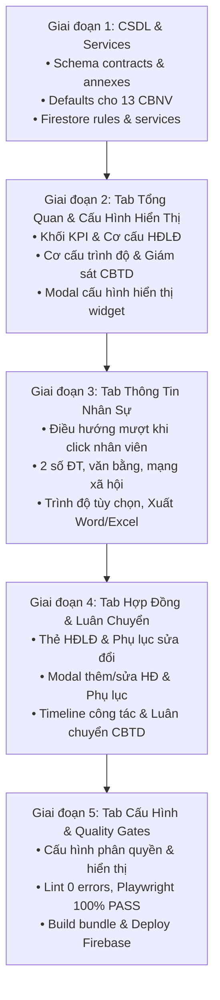

# KẾ HOẠCH RÀ SOÁT & ĐIỀU CHỈNH TOÀN DIỆN PHÂN HỆ QUẢN TRỊ NHÂN SỰ
## HỆ THỐNG QUẢN TRỊ NHÂN SỰ (HRM) — QUỸ TÍN DỤNG NHÂN DÂN YÊN THỌ

> **Ngày lập kế hoạch:** 13/10/2026  
> **Cơ quan áp dụng:** Quỹ Tín Dụng Nhân Dân Yên Thọ (Thôn Tân Lộc, xã Quý Lộc, Thanh Hóa)  
> **Tuyến đường (Route):** `/employees`  
> **Mục tiêu:** Tái cấu trúc và chuẩn hóa toàn diện Phân hệ Nhân sự thành **5 phân khu chức năng mạch lạc**, đáp ứng 100% yêu cầu nghiệp vụ ngân hàng hợp tác, loại bỏ hoàn toàn mã kỹ thuật/font mono, và hỗ trợ quản trị Hợp đồng lao động đa phiên bản kèm phụ lục sửa đổi bổ sung.

---

## 🏛️ I. TỔNG QUAN HIỆN TRẠNG & ĐỊNH HƯỚNG TÁI CẤU TRÚC

### 1. Hiện trạng phân hệ nhân sự
- Phân hệ hiện tại gồm 5 tab: `PROFILE` (Hồ sơ), `TRANSFERS` (Luân chuyển), `TRAINING` (Đào tạo), `ANALYTICS` (Cơ cấu & Thống kê), `SETTINGS` (Cấu hình).
- **Hạn chế tồn tại**:
  1. Chưa có màn hình **Tổng quan** bao quát độc lập ngay từ đầu; người dùng vào hệ thống bị đưa thẳng vào hồ sơ cá nhân của nhân viên đầu tiên.
  2. **Hợp đồng lao động** hiện chỉ là một trường chuỗi văn bản đơn giản (`contractType: 'Không xác định thời hạn'`) nằm trong hồ sơ nhân viên; chưa có bảng CSDL quản lý chi tiết số HĐLĐ, ngày ký, ngày hiệu lực, ngày hết hạn, mức lương/hệ số, người ký đại diện, và **chưa có cơ chế theo dõi các Phụ lục sửa đổi bổ sung HĐLĐ**.
  3. Mối liên kết giữa Hợp đồng lao động, Quyết định điều động bổ nhiệm và Luân chuyển vị trí công tác (địa bàn CBTD) chưa được gom chung vào một bức tranh pháp lý thống nhất.
  4. Màn hình Thống kê cơ cấu (`ANALYTICS`) chưa có tính năng **Cấu hình hiển thị** (bật/tắt các khối widget) theo nhu cầu thực tế của Ban Lãnh đạo.

### 2. Định hướng 5 phân khu chuẩn mực theo yêu cầu người dùng
Hệ thống sẽ được chuẩn hóa thành 5 phân khu chức năng đồng nhất trên cả Desktop (`HRModuleTabsNav`) và Mobile (`HRBottomNav`):

```
                        ┌─────────────────────────────────────────────────────────┐
                        │      PHÂN HỆ QUẢN TRỊ NHÂN SỰ (QTDND YÊN THỌ)           │
                        └──────────────────────────┬──────────────────────────────┘
                                                   │
     ┌──────────────────────┬──────────────────────┼──────────────────────┬──────────────────────┐
     ▼                      ▼                      ▼                      ▼                      ▼
┌──────────────┐      ┌──────────────┐      ┌──────────────┐      ┌──────────────┐      ┌──────────────┐
│  TỔNG QUAN   │      │  THÔNG TIN   │      │   HỢP ĐỒNG   │      │   ĐÀO TẠO    │      │   CẤU HÌNH   │
│  NHÂN SỰ     │      │   NHÂN SỰ    │      │  & LUÂN CHUYỂN│      │ & CHỨNG CHỈ  │      │ & PHÂN QUYỀN │
│              │      │              │      │              │      │              │      │              │
│ • Bức tranh  │      │ • Chi tiết   │      │ • HĐLĐ chính │      │ • Khóa bồi   │      │ • Phạm vi    │
│   nhân lực   │      │   từng CBNV  │      │   thức       │      │   dưỡng NHNN │      │   danh bạ    │
│ • Chỉ số KPI │      │ • Lý lịch 2C │      │ • Phụ lục    │      │ • Chứng chỉ  │      │ • Chu kỳ đổi │
│ • Biểu đồ HĐ │      │ • 2 Số ĐT    │      │   sửa đổi    │      │   chức danh  │      │   địa bàn CB │
│ • Trình độ   │      │ • Văn bằng   │      │ • Timeline   │      │ • Kế hoạch   │      │ • Cấu hình   │
│ • Giám sát CB│      │ • Mạng XH    │      │   công tác   │      │   cử đi học  │      │   hiển thị   │
│ • CẤU HÌNH   │      │ • Xuất Word, │      │ • Quyết định │      │ • Xem bản    │      │ • Danh mục   │
│   HIỂN THỊ   │      │   Excel, In  │      │   bổ nhiệm   │      │   scan       │      │   phòng ban  │
└──────────────┘      └──────────────┘      └──────────────┘      └──────────────┘      └──────────────┘
```

---

## 📋 II. CHI TIẾT ĐẶC TẢ TỪNG PHÂN KHU NGHIỆP VỤ

### 1. Phân khu 1: Tổng quan nhân sự lao động của Quỹ (`OVERVIEW`)
- **Vị trí**: Tab số 1 trên thanh điều hướng. Mặc định hiển thị bức tranh toàn cảnh khi người dùng truy cập phân hệ mà chưa chọn cụ thể cán bộ nào.
- **Nội dung hiển thị**:
  1. **Thẻ Chỉ Số KPI Nhân Lực Toàn Quỹ**:
     - Tổng số CBNV (13 cán bộ chính thức).
     - Tỷ lệ Đảng viên ĐCSVN (% và số lượng).
     - Cơ cấu Giới tính (Nam / Nữ, số lượng và %).
     - Thâm niên bình quân tại Quỹ (năm/tháng).
     - Hạn luân chuyển CBTD (Đến hạn / Sắp đến hạn).
  2. **Cơ cấu Hợp đồng Lao động (Mới)**:
     - Biểu đồ phân bổ tỷ lệ các loại HĐLĐ: Không xác định thời hạn, Xác định thời hạn (12 - 36 tháng), Thử việc, HĐ khoán việc.
     - Cảnh báo các hợp đồng sắp hết hạn trong 30-60 ngày cần chuẩn bị tái ký.
  3. **Cơ cấu Trình độ Chuyên môn & Học vị**:
     - Biểu đồ và tỷ lệ % phân theo văn bằng cao nhất: Sau đại học / Tiến sĩ, Thạc sĩ, Đại học, Cao đẳng, Trung cấp. Dữ liệu tính toán động từ bảng `employee_degrees`.
  4. **Bảng Giám sát Chu kỳ Luân chuyển Địa bàn Cán bộ Tín dụng (CBTD)**:
     - Giám sát thời gian phụ trách địa bàn (thôn/cụm/xã) của từng CBTD theo chu kỳ quy định NHNN (cấu hình động `creditRotationMonths`).
     - Cảnh báo trực quan: Đến hạn (đỏ), Sắp đến hạn (vàng), An toàn (xanh).
     - Click vào một dòng cán bộ tín dụng $\rightarrow$ Tự động mở ngay hồ sơ của cán bộ đó.
  5. **Cơ cấu Phân bổ Nhân sự theo Bộ phận**:
     - Phân bổ theo Hội đồng quản trị, Ban Kiểm soát, Ban Điều hành, Phòng Tín dụng, Bộ phận Kế toán - Ngân quỹ.
  6. **Tính năng Cấu hình Hiển thị (Display Config)**:
     - Nút "Cấu hình hiển thị" đặt tại Header của Tab Tổng quan (hoặc trong Tab Cấu hình).
     - Hộp thoại (Modal) cho phép người dùng tick chọn bật/tắt hiển thị từng khối widget:
       * `[x]` Khối Thống kê Chỉ số KPI Tổng quan
       * `[x]` Khối Cơ cấu Hợp đồng Lao động
       * `[x]` Khối Cơ cấu Trình độ Chuyên môn & Học vị
       * `[x]` Khối Bảng Giám sát Luân chuyển Địa bàn CBTD
       * `[x]` Khối Phân bổ Nhân sự theo Bộ phận
     - Cơ chế lưu: Lưu vào `localStorage` cho người dùng hiện tại và lưu vào Firestore `system_settings/module_hr` (`overviewDisplayConfig`) cho cấu hình mặc định toàn Quỹ.

---

### 2. Phân khu 2: Thông tin nhân sự (`PROFILE`)
- **Vị trí**: Tab số 2 trên thanh điều hướng. Tự động kích hoạt khi người dùng click vào một nhân viên từ Danh bạ (Sidebar) hoặc từ danh sách trên tab Tổng quan.
- **Bố cục Master - Detail chuyên nghiệp**:
  - **Cột trái (Sidebar Danh bạ)**:
    + Ô tìm kiếm nhanh đa trường (Họ tên, chức vụ, phòng ban, SĐT, địa bàn phụ trách).
    + Danh sách 13 cán bộ với ảnh đại diện, họ tên, chức danh, nhãn "Đảng viên", địa bàn CBTD.
    + Nút "+ Thêm cán bộ" (chỉ hiển thị khi có quyền quản trị).
  - **Cột phải (Hồ sơ Chi tiết Trích ngang)**:
    + **Header Cán bộ**: Ảnh đại diện Avatar (hỗ trợ thay ảnh nén Canvas), Họ tên, Chức vụ, Phòng ban, Trạng thái (Đang công tác/Nghỉ việc), Huy hiệu Đảng viên.
    + **Hàng nút tác vụ Doanh nghiệp**:
      * `[Xuất Word (.docx)]`: Sơ yếu lý lịch chuẩn văn bản hành chính Việt Nam.
      * `[Xuất Excel (.xlsx)]`: Đa sheet (Lý lịch, Lịch sử công tác, Văn bằng, Mạng xã hội).
      * `[In trích ngang A4]`: Bản in chuẩn 2C/TCTD.
      * `[Chỉnh sửa hồ sơ]`: Mở modal cập nhật thông tin.
      * `[Xóa hồ sơ]`: Xóa an toàn kèm xác nhận mật khẩu/vai trò quản trị.
    + **Phân khu 1 - Thông tin nhân thân & Liên hệ**:
      * Ngày sinh, Giới tính, Dân tộc, Tôn giáo.
      * Số CCCD (12 chữ số), Ngày cấp, Nơi cấp.
      * **Số điện thoại chính & Số điện thoại phụ / Liên hệ thứ 2**, Email công vụ.
      * Nơi ở hiện nay, Hộ khẩu thường trú, Quê quán.
    + **Phân khu 2 - Vị trí công tác & Nơi làm việc**:
      * Chức vụ chính quyền, Phòng ban công tác.
      * Nơi làm việc (Trụ sở chính / Phòng giao dịch Quý Lộc / Yên Thọ...).
      * Ngày vào Quỹ, Ngày giữ chức vụ, Thâm niên chức vụ, Tổng thâm niên tại Quỹ.
      * *Nếu là Cán bộ Tín dụng*: Địa bàn quản lý hiện tại, Ngày nhận địa bàn, Thâm niên địa bàn, Thời điểm luân chuyển định kỳ.
    + **Phân khu 3 - Chính trị & Đảng - Đoàn thể**:
      * Đảng viên ĐCSVN, Ngày vào Đảng, Ngày chính thức, Chức vụ Chi bộ.
    + **Phân khu 4 - Danh mục Văn bằng Chuyên môn Đào tạo (`employee_degrees`)**:
      * Hiển thị danh sách văn bằng (Đại học, Thạc sĩ, Cao đẳng...).
      * Nút "+ Thêm văn bằng" mở `AddDegreeModal`.
      * Nút sửa/xóa từng văn bằng.
    + **Phân khu 5 - Mạng Xã Hội & Kênh Liên Lạc Số (`employee_socials`)**:
      * Hiển thị icon và link Zalo, Facebook, LinkedIn...
      * Nút "Quản lý liên hệ số" mở `ManageSocialsModal`.
    + **Phân khu 6 - Trình độ Tin học & Ngoại ngữ**:
      * Hiển thị trình độ tin học, ngoại ngữ (hoặc "Chưa cập nhật").
      * Nút "Chỉnh sửa" mở `EditSkillsModal` (100% không bắt buộc, cho phép để trống).

---

### 3. Phân khu 3: Hợp đồng lao động & Luân chuyển vị trí (`CONTRACTS`)
- **Vị trí**: Tab số 3 trên thanh điều hướng. Gom toàn bộ hồ sơ pháp lý lao động và quá trình luân chuyển vị trí công tác của cán bộ đang chọn vào một màn hình duy nhất.
- **Nội dung 3 khối nghiệp vụ chuyên sâu**:
  
  #### Khối A: Hợp đồng lao động hiện tại & Các Phụ lục sửa đổi bổ sung
  - **Thẻ Card Hợp đồng hiện hành**:
    + Số HĐLĐ (VD: `03/2021/HĐLĐ-QTD`).
    + Loại hợp đồng: HĐLĐ không xác định thời hạn / Xác định thời hạn / Thử việc.
    + Ngày ký, Ngày có hiệu lực, Ngày hết hạn (đối với HĐ có thời hạn).
    + Vị trí công việc & Nơi làm việc theo HĐLĐ.
    + Mức lương cơ bản / Hệ số lương ký kết.
    + Người ký đại diện Quỹ (Chủ tịch HĐQT / Giám đốc).
    + Trạng thái: "Đang hiệu lực" (Badge xanh lá).
    + Nút "Sửa HĐLĐ" và nút "+ Thêm Phụ lục sửa đổi bổ sung".
  - **Danh sách Phụ lục HĐLĐ sửa đổi bổ sung (`employee_contract_annexes`)**:
    + Hiển thị dạng Timeline các lần ký phụ lục:
      * Số phụ lục (VD: `PL01/2023/HĐLĐ-QTD`), Ngày ký, Ngày hiệu lực.
      * Loại sửa đổi: "Điều chỉnh tiền lương & phụ cấp", "Điều chỉnh chức danh & công việc", "Gia hạn thời hạn hợp đồng", "Điều chỉnh nơi làm việc / địa bàn".
      * Nội dung chi tiết sửa đổi, bổ sung.
      * Người ký đại diện Quỹ.
      * Xem ảnh scan văn bản phụ lục (nếu có).

  #### Khối B: Lịch sử các Hợp đồng lao động đã ký trong quá khứ
  - Bảng hoặc danh sách các hợp đồng trước đây của cán bộ:
    * HĐ Thử việc $\rightarrow$ HĐ Có thời hạn 12-36 tháng $\rightarrow$ HĐ Không xác định thời hạn.
    * Ghi nhận ngày kết thúc, lý do chuyển đổi hoặc chấm dứt HĐ cũ.

  #### Khối C: Quá trình Công tác & Luân chuyển vị trí (`work_history`)
  - **Thanh đo tiến độ luân chuyển vị trí / địa bàn CBTD**:
    + Nếu là Cán bộ Tín dụng: Đo chu kỳ quản lý địa bàn (tháng hiện tại / chu kỳ quy định), tự động phát cảnh báo khi sắp đến hạn.
    + Nếu là chức danh HĐQT, BKS, Giám đốc, Kế toán, Thủ quỹ: Hiển thị nhãn "Theo dõi theo nhiệm kỳ / phân công nội bộ".
  - **Timeline Mốc Quá Trình Công Tác Chi Tiết**:
    + Nút "+ Thêm mốc công tác" mở `WorkHistoryPeriodModal`.
    + Mốc hiện tại (`isCurrent: true`) hiển thị nổi bật với viền ngọc bích.
    + Các mốc trong quá khứ sắp xếp theo thứ tự thời gian giảm dần.
    + Mỗi mốc thể hiện rõ:
      * Thời gian: Từ ngày ... đến ngày ... (hoặc Đến nay).
      * Chức danh & Phòng ban công tác.
      * Nơi làm việc (Trụ sở chính / Phòng giao dịch).
      * Địa bàn quản lý tín dụng (đối với CBTD).
      * Quyết định điều động/bổ nhiệm: Số QĐ, Ngày ký, Người ký.
      * Ghi chú nhiệm vụ.
      * Nút Sửa mốc và Xóa mốc an toàn.

---

### 4. Phân khu 4: Đào tạo & Chứng chỉ nghiệp vụ (`TRAINING`)
- **Vị trí**: Tab số 4 trên thanh điều hướng. Quản lý toàn bộ lịch sử các khóa đào tạo, bồi dưỡng nghiệp vụ và chứng chỉ chuyên môn của cán bộ đang chọn.
- **Nội dung hiển thị**:
  1. Thống kê nhanh: Tổng số khóa đào tạo đã tham gia, số chứng chỉ chuyên môn đã được cấp.
  2. Bộ lọc theo phân loại chứng chỉ: Tất cả, Nghiệp vụ QTDND, Quản trị điều hành, Thẩm định tài sản, Tin học, Ngoại ngữ.
  3. Danh sách các khóa đào tạo (`employee_training`):
     - Tên khóa học / Chứng chỉ nghiệp vụ.
     - Cơ sở / Đơn vị tổ chức đào tạo (NHNN, Hiệp hội QTDND, Học viện Ngân hàng...).
     - Quyết định hoặc Kế hoạch cử cán bộ đi học của Quỹ.
     - Thời gian đào tạo (Từ ngày - Đến ngày).
     - Số hiệu văn bằng/chứng chỉ, Ngày cấp, Thời hạn chứng chỉ (nếu có).
     - Kết quả / Xếp loại đào tạo.
     - Bản scan chứng chỉ (xem trực tiếp trên thẻ, click để mở popup phóng to).
  4. Thao tác nghiệp vụ:
     - Nút "+ Thêm khóa đào tạo / Chứng chỉ" mở modal nhập liệu.
     - Nút Chỉnh sửa thông tin khóa đào tạo.
     - Nút Xóa thông tin đào tạo (kèm hộp thoại xác nhận an toàn).
     - Cán bộ nhân viên có thể tự cập nhật chứng chỉ bồi dưỡng của mình khi cấu hình cho phép.

---

### 5. Phân khu 5: Cấu hình & Phân quyền truy cập (`SETTINGS`)
- **Vị trí**: Tab số 5 trên thanh điều hướng. Chỉ hiển thị và cho phép thao tác đối với Ban Lãnh đạo (Chủ tịch HĐQT, Giám đốc, BKS) và Quản trị viên (`canManage === true`).
- **Nội dung 4 khối cấu hình tập trung**:
  1. **Khối 1: Phân Quyền Truy Cập Phân Hệ Nhân Sự**:
     - *Phạm vi xem danh bạ cán bộ*:
       * `(o) Xem toàn Quỹ`: Cho phép mọi cán bộ tra cứu danh bạ cơ bản của đồng nghiệp trong Quỹ.
       * `( ) Chỉ xem hồ sơ cá nhân`: Chế độ bảo mật, cán bộ chỉ xem hồ sơ của mình; Lãnh đạo xem toàn bộ.
     - *Quyền cập nhật văn bằng & chứng chỉ*:
       * `[x] Cho phép cán bộ tự cập nhật văn bằng, chứng chỉ đào tạo`.
  2. **Khối 2: Cấu Hình Luân Chuyển Địa Bàn Cán Bộ Tín Dụng (CBTD)**:
     - *Chu kỳ luân chuyển địa bàn*: Ô nhập số tháng tự do (mặc định 36 tháng, tương đương 3 năm). Cho phép xóa và gõ số tùy ý, tự chuẩn hóa khi rời ô.
     - *Thời gian cảnh báo trước*: Ô nhập số tháng tự do (mặc định 6 tháng).
  3. **Khối 3: Cấu Hình Hiển Thị Dashboard Tổng Quan (Mới)**:
     - Danh sách các checkbox cho phép Ban Lãnh đạo bật/tắt từng khối thông tin trên màn hình Tổng quan:
       * `[x] Khối Thống kê Chỉ số KPI Tổng quan`
       * `[x] Khối Cơ cấu Hợp đồng Lao động`
       * `[x] Khối Cơ cấu Trình độ Chuyên môn & Học vị`
       * `[x] Khối Bảng Giám sát Luân chuyển Địa bàn CBTD`
       * `[x] Khối Phân bổ Nhân sự theo Bộ phận`
  4. **Khối 4: Danh Mục Phòng Ban & Địa Bàn Tín Dụng Chuẩn Mực**:
     - Danh sách các phòng ban hoạt động của Quỹ TDND Yên Thọ.
     - Danh mục các địa bàn tín dụng phụ trách (Thôn/Cụm/Xã).
  5. **Nút "Lưu Cấu Hình"**:
     - Lưu đồng thời lên Cloud Firestore (`system_settings/module_hr`) và bộ nhớ đệm `localStorage`.
     - Hiển thị thông báo thành công tức thì qua hệ thống Toast.

---

## 🗄️ III. THIẾT KẾ CƠ SỞ DỮ LIỆU & TYPE CONTRACT

### 1. Bảng Hợp Đồng Lao Động (`employee_contracts`)
```typescript
interface EmployeeContract {
  id: string; // VD: 'contract-cb01-1'
  employeeId: string; // ID liên kết cán bộ (VD: 'emp-001')
  employeeCode: string; // Mã cán bộ (VD: 'CB01')
  employeeName: string; // Họ và tên cán bộ
  contractNumber: string; // Số HĐLĐ (VD: '01/2020/HĐLĐ-QTD')
  contractType: 
    | 'Không xác định thời hạn'
    | 'Xác định thời hạn 36 tháng'
    | 'Xác định thời hạn 24 tháng'
    | 'Xác định thời hạn 12 tháng'
    | 'Hợp đồng thử việc'
    | 'Hợp đồng khoán việc';
  signDate: string; // Ngày ký kết (YYYY-MM-DD)
  effectiveDate: string; // Ngày có hiệu lực (YYYY-MM-DD)
  expirationDate?: string; // Ngày hết hạn (đối với HĐ có thời hạn)
  jobTitle: string; // Vị trí / Chức danh theo HĐ (VD: 'Cán bộ tín dụng')
  department: string; // Phòng ban ký kết (VD: 'Phòng Tín dụng')
  workLocation: string; // Nơi làm việc theo HĐ (VD: 'Trụ sở chính - Quỹ TDND Yên Thọ')
  wageType: string; // Hình thức lương (VD: 'Lương theo ngạch bậc & chức danh')
  baseSalary?: string; // Mức lương / Hệ số lương ký kết
  signerName: string; // Người đại diện Quỹ ký HĐ (VD: 'Trịnh Đức Anh' hoặc 'Nguyễn Văn Sơn')
  signerPosition: string; // Chức vụ người ký ('Chủ tịch Hội đồng Quản trị' hoặc 'Giám đốc')
  status: 'ACTIVE' | 'RENEWED' | 'EXPIRED' | 'TERMINATED'; // Trạng thái hợp đồng
  isCurrent: boolean; // Cờ đánh dấu HĐ hiện tại đang áp dụng
  attachmentUrl?: string; // Ảnh / file scan HĐLĐ (Base64 WebP nén)
  notes?: string; // Ghi chú hợp đồng
  createdAt: string; // ISO 8601
  updatedAt: string; // ISO 8601
}
```

### 2. Bảng Phụ Lục Hợp Đồng Lao Động (`employee_contract_annexes`)
```typescript
interface ContractAnnex {
  id: string; // VD: 'annex-cb01-pl01'
  contractId: string; // ID hợp đồng gốc liên kết
  contractNumber: string; // Số HĐLĐ gốc
  employeeId: string; // ID cán bộ
  employeeName: string; // Họ tên cán bộ
  annexNumber: string; // Số phụ lục (VD: 'PL01/2023/HĐLĐ-QTD')
  signDate: string; // Ngày ký phụ lục (YYYY-MM-DD)
  effectiveDate: string; // Ngày có hiệu lực (YYYY-MM-DD)
  annexType: 
    | 'TIEU_LUONG' // Điều chỉnh tiền lương, hệ số và phụ cấp
    | 'CHUC_DANH' // Điều chỉnh chức danh, vị trí và công việc
    | 'GIA_HAN' // Gia hạn thời hạn hợp đồng lao động
    | 'NOI_LAM_VIEC' // Thay đổi nơi làm việc / địa bàn hoạt động
    | 'DIEU_KHOAN_KHAC'; // Sửa đổi điều khoản khác
  annexTypeLabel: string; // Nhãn hiển thị tiếng Việt
  content: string; // Nội dung sửa đổi, bổ sung chi tiết
  signerName: string; // Người ký đại diện Quỹ
  signerPosition: string; // Chức vụ người ký
  attachmentUrl?: string; // Bản scan phụ lục
  notes?: string; // Ghi chú
  createdAt: string;
  updatedAt: string;
}
```

### 3. Cấu hình CSDL phân hệ (`system_settings/module_hr`)
```typescript
interface HrSubsystemConfig {
  moduleKey: 'hr';
  allowStaffViewDirectory: boolean; // true = Xem toàn Quỹ, false = Chỉ xem cá nhân
  canStaffUploadTraining: boolean; // true = Cán bộ tự cập nhật văn bằng chứng chỉ
  creditRotationMonths: number; // Mặc định 36 tháng
  creditWarningMonths: number; // Mặc định 6 tháng
  overviewDisplayConfig: {
    showKpis: boolean; // Mặc định true
    showContractStructure: boolean; // Mặc định true
    showEducationStructure: boolean; // Mặc định true
    showCreditRotationMonitoring: boolean; // Mặc định true
    showDepartmentDistribution: boolean; // Mặc định true
  };
  transferRules: [
    { positionName: 'Cán bộ tín dụng', requiresTransfer: true, maxMonths: number, warningMonths: number }
  ];
  updatedAt: any; // serverTimestamp
}
```

---

## 🛠️ IV. KẾ HOẠCH TRIỂN KHAI THEO TỪNG GIAI ĐOẠN



---

### Chi tiết các bước thực hiện:

#### GIAI ĐOẠN 1: NÂNG CẤP CSDL FIRESTORE, SECURITY RULES & SERVICES (DB LAYER)
1. **Bổ sung Default Data trong `src/lib/systemDefaults.js`**:
   - Thêm `DEFAULT_EMPLOYEE_CONTRACTS`: Khởi tạo sẵn 13 hợp đồng lao động chuẩn hóa cho 13 cán bộ nhân viên của Quỹ (mã số từ `01/2018/HĐLĐ-QTD` đến `13/2024/HĐLĐ-QTD`), ngày ký tương ứng ngày vào Quỹ, loại HĐ không xác định thời hạn hoặc có thời hạn, người ký là Chủ tịch HĐQT / Giám đốc.
   - Thêm `DEFAULT_CONTRACT_ANNEXES`: Khởi tạo các phụ lục sửa đổi bổ sung mẫu (điều chỉnh chức danh, lương, địa bàn).
   - Bổ sung `DEFAULT_HR_CONFIG.overviewDisplayConfig` với các cờ hiển thị mặc định `true`.
2. **Cập nhật `src/lib/autoInitDb.js`**:
   - Bổ sung bước tự động đồng bộ bảng `employee_contracts` và `employee_contract_annexes` khi khởi tạo CSDL hoặc nâng cấp phiên bản schema.
3. **Cập nhật `firestore.rules`**:
   - Thêm quyền truy cập cho `employee_contracts` và `employee_contract_annexes`:
     * `read: if isAuthenticated();` (Cán bộ xem thông tin hợp đồng của Quỹ).
     * `write: if isBoardOrAdmin();` (Chỉ Lãnh đạo/Admin được thêm, sửa, xóa hợp đồng và phụ lục).
4. **Triển khai Services trong `src/lib/services.js`**:
   - `subscribeEmployeeContracts(employeeId, callback)`
   - `saveEmployeeContract(contractData)`
   - `deleteEmployeeContract(contractId)`
   - `subscribeContractAnnexes(contractIdOrEmployeeId, callback)`
   - `saveContractAnnex(annexData)`
   - `deleteContractAnnex(annexId)`

---

#### GIAI ĐOẠN 2: TÁI CẤU TRÚC TAB TỔNG QUAN (`EmployeeOverviewTab.jsx`) & CẤU HÌNH HIỂN THỊ
1. Tạo component `src/features/employees/components/EmployeeOverviewTab.jsx` (thay thế hoặc nâng cấp từ `EmployeeAnalyticsTab.jsx`):
   - Header tab: Tiêu đề "Tổng Quan Nhân Lực Quỹ Tín Dụng Nhân Dân Yên Thọ", nút "Cấu hình hiển thị" góc phải.
   - Render có điều kiện từng khối theo `overviewDisplayConfig`:
     * Khối 1: Thẻ chỉ số nhân lực KPI.
     * Khối 2: Biểu đồ cơ cấu Hợp đồng lao động & cảnh báo hợp đồng sắp hết hạn.
     * Khối 3: Biểu đồ cơ cấu Trình độ chuyên môn & học vị.
     * Khối 4: Bảng giám sát thời hạn luân chuyển địa bàn CBTD (Click vào hàng cán bộ $\rightarrow$ chuyển sang tab Thông tin nhân sự của cán bộ đó).
     * Khối 5: Cơ cấu phân bổ nhân sự theo phòng ban/bộ phận.
2. Tạo component `src/features/employees/components/OverviewDisplayConfigModal.jsx`:
   - Modal cho phép bật/tắt các khối widget và lưu vào cấu hình.

---

#### GIAI ĐOẠN 3: HOÀN THIỆN TAB THÔNG TIN NHÂN SỰ (`EmployeeProfileDetail.jsx`)
1. Điều phối mượt mà giữa Danh bạ (Sidebar) và Màn hình chi tiết:
   - Khi người dùng click chọn cán bộ từ Sidebar hoặc từ bảng Tổng quan $\rightarrow$ tự động kích hoạt tab `PROFILE` và nạp dữ liệu chi tiết của cán bộ đó.
2. Kiểm tra toàn diện các phân khu:
   - Thông tin nhân thân & 2 số điện thoại (chính + phụ).
   - Vị trí công tác, thâm niên chức vụ, thâm niên tại Quỹ, nơi làm việc.
   - Phân công địa bàn tín dụng của CBTD.
   - Thông tin Đảng viên, Chức vụ Chi bộ.
   - Danh sách văn bằng chuyên môn đa cấp từ `employee_degrees`.
   - Danh sách liên hệ số từ `employee_socials`.
   - Trình độ Tin học & Ngoại ngữ (tùy chọn, cập nhật tức thì).
   - Bộ công cụ xuất báo cáo (Word, Excel, In trích ngang A4).

---

#### GIAI ĐOẠN 4: XÂY DỰNG TAB HỢP ĐỒNG LAO ĐỘNG & LUÂN CHUYỂN (`EmployeeContractHistoryTab.jsx`)
1. Tạo component `src/features/employees/components/EmployeeContractHistoryTab.jsx` (hợp nhất và nâng cấp từ `EmployeeTransferHistory.jsx`):
   - **Phần 1: Hợp đồng lao động & Phụ lục**:
     * Thẻ thông tin Hợp đồng lao động đang hiệu lực của cán bộ.
     * Nút "Sửa hợp đồng" và nút "+ Thêm phụ lục HĐLĐ".
     * Danh sách các Phụ lục sửa đổi bổ sung HĐLĐ đã ký.
     * Danh sách các Hợp đồng lao động đã từng ký trong quá khứ.
   - **Phần 2: Quá trình Công tác & Luân chuyển vị trí (`work_history`)**:
     * Khung giám sát tiến độ luân chuyển địa bàn CBTD.
     * Timeline mốc quá trình công tác (tích hợp `WorkHistoryPeriodModal`).
     * Đầy đủ số quyết định điều động, người ký, nơi làm việc, địa bàn CBTD.
2. Tạo component `src/features/employees/components/ContractFormModal.jsx`:
   - Modal tạo mới / sửa Hợp đồng lao động với các trường chuẩn mực: Số HĐ, Loại HĐ, Ngày ký, Ngày hiệu lực, Ngày hết hạn, Vị trí, Mức lương/Hệ số, Người ký đại diện, File scan đính kèm.
3. Tạo component `src/features/employees/components/ContractAnnexModal.jsx`:
   - Modal tạo mới Phụ lục HĐLĐ sửa đổi bổ sung: Số phụ lục, Ngày ký, Ngày hiệu lực, Phân loại sửa đổi (Lương, Chức danh, Gia hạn, Nơi làm việc), Nội dung chi tiết, Người ký.

---

#### GIAI ĐOẠN 5: CHUẨN HÓA THANH ĐIỀU HƯỚNG, TAB CẤU HÌNH & KIỂM THỬ KHÉP KÍN
1. Cập nhật `src/features/employees/components/HRModuleTabsNav.jsx` & `HRBottomNav.jsx`:
   - 5 Tab chuẩn hóa:
     * `OVERVIEW`: Tổng quan nhân lực
     * `PROFILE`: Thông tin nhân sự
     * `CONTRACTS`: Hợp đồng & Luân chuyển
     * `TRAINING`: Đào tạo & Chứng chỉ
     * `SETTINGS`: Cấu hình & Phân quyền
2. Cập nhật `src/features/employees/components/EmployeeSettingsTab.jsx`:
   - Bổ sung cấu hình hiển thị Tổng quan vào tab Cài đặt.
   - Đảm bảo các ô nhập chu kỳ số gõ tự do, lưu trữ an toàn.
3. Cập nhật `src/features/employees/EmployeesContainer.jsx`:
   - Đảm bảo kết nối đồng bộ 5 tabs, realtime listener cho `employee_contracts` và `employee_contract_annexes`.
4. **Kiểm thử khép kín (Quality Gates)**:
   - `npm run lint` $\rightarrow$ Đạt **0 errors**.
   - Bổ sung test Playwright kiểm thử hợp đồng lao động và cấu hình hiển thị $\rightarrow$ Đạt **100% tests PASS**.
   - `npm run build` $\rightarrow$ Đạt **Exit Code 0** hoàn tất production bundle.
   - Deploy lên Firebase Hosting và kiểm tra trực tiếp.

---

## 🔒 V. CAM KẾT CHUẨN MỰC THIẾT KẾ (DESIGN INTEGRITY)

1. **Chuẩn Mực Cơ Quan Tín Dụng — Zero AI / Tech Jargon**:
   - Tuyệt đối không dùng các từ ngữ mang tính kỹ thuật/AI: "canvas", "thuật toán", "tự động nén", "AI", "UUID", "mock".
   - 100% sử dụng thuật ngữ chuẩn mực của ngành Ngân hàng và Quỹ tín dụng nhân dân: "Hợp đồng lao động", "Phụ lục hợp đồng lao động", "Quyết định điều động", "Luân chuyển địa bàn", "Trích ngang 2C/TCTD".
2. **Ẩn 100% Mã Kỹ Thuật (Zero Technical ID Exposure)**:
   - Không hiển thị UUID, mã code nội bộ `emp-xxx`, `pos-xxx`, `acc-xxx` trên giao diện người dùng và bản in.
3. **Typography Chuẩn Doanh Nghiệp**:
   - Cấm triệt để font monospace (`font-mono`) răng cưa. Sử dụng font `Be Vietnam Pro` / `Inter`, số liệu dùng `tabular-nums` căn thẳng hàng.
4. **Bảo Toàn Dữ Liệu 100% (Zero Data Loss)**:
   - Mọi nâng cấp CSDL đều tuân thủ Self-Healing Schema, bảo toàn toàn bộ 13 hồ sơ cán bộ, quá trình công tác, văn bằng và chứng chỉ hiện có.
